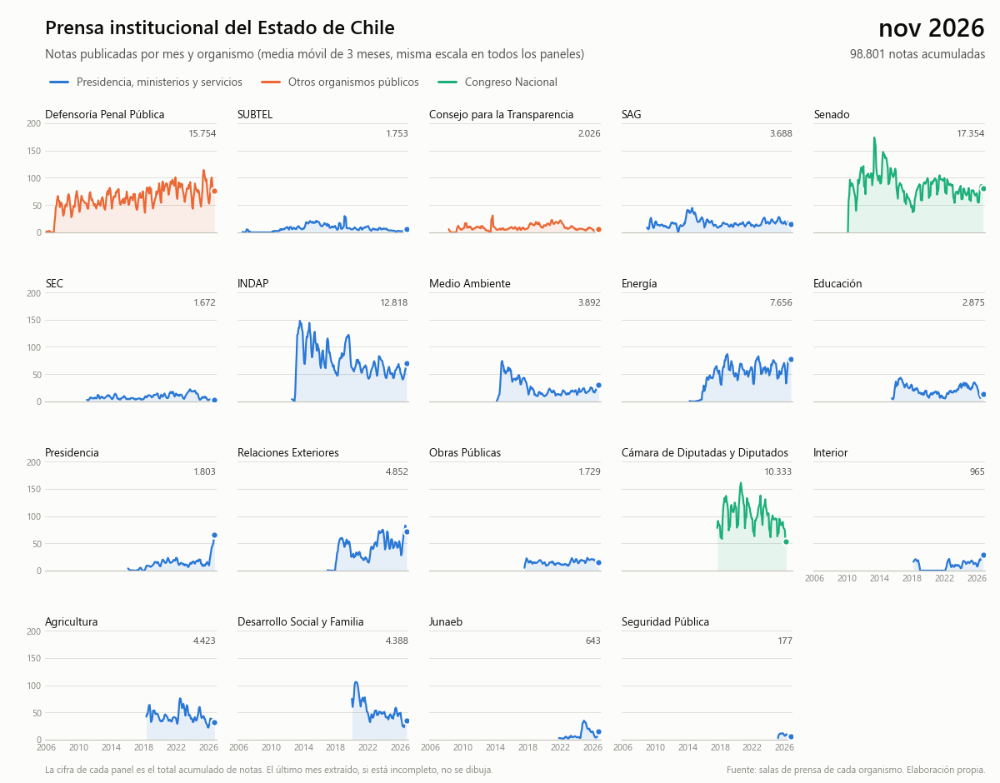
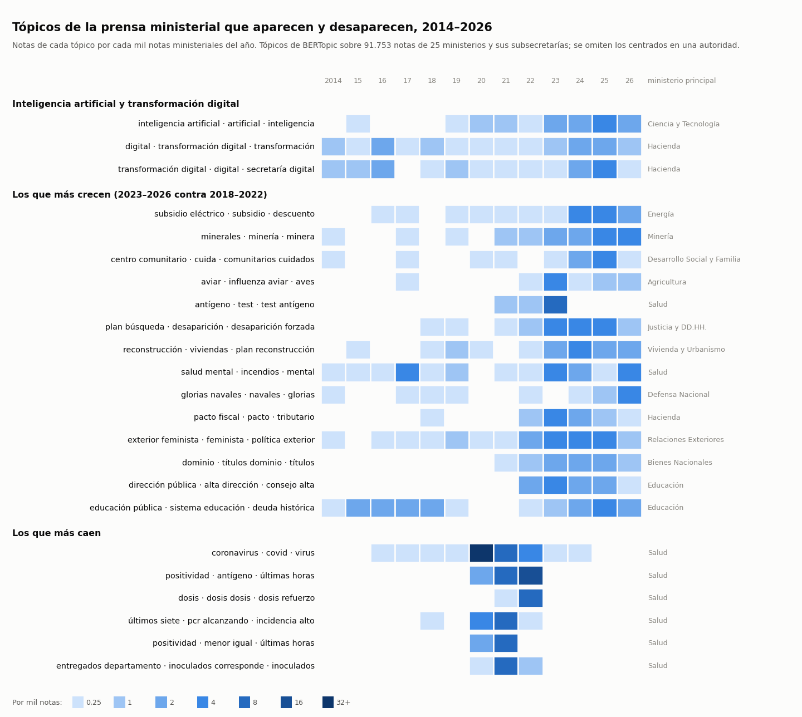
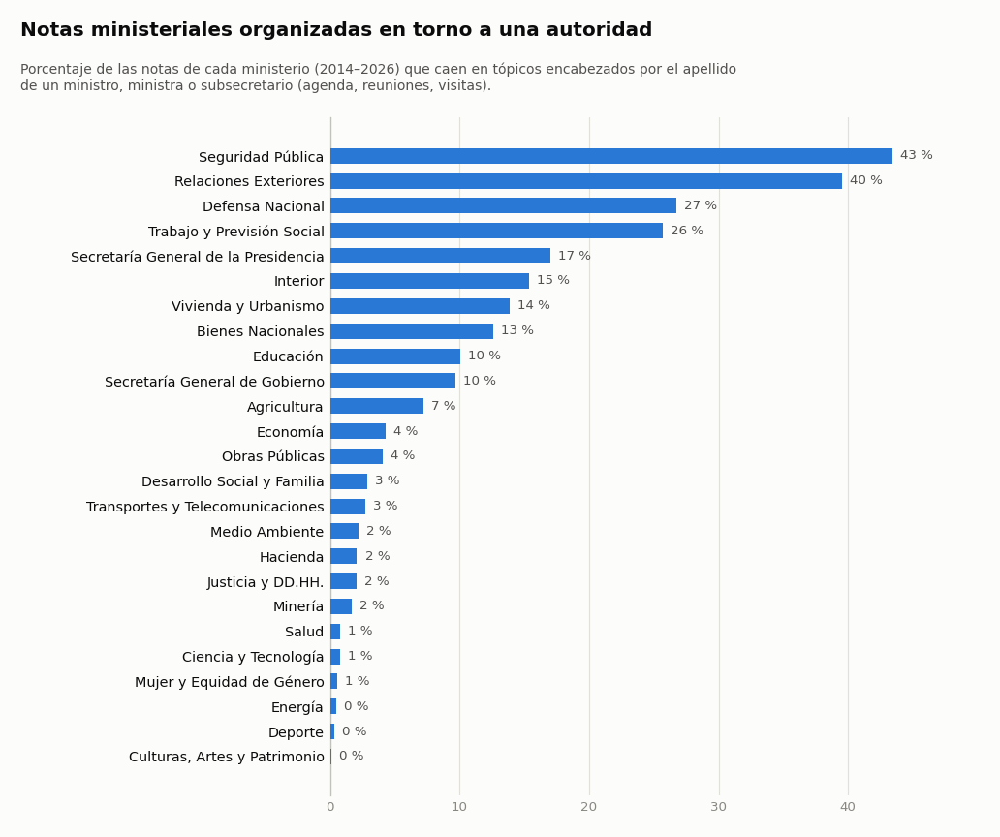

# Prensa institucional

Extracción de las notas de prensa que publican en sus sitios web los organismos del Estado de Chile: Presidencia, ministerios y subsecretarías, servicios públicos, servicios de salud y hospitales, servicios locales de educación pública, gobiernos regionales y delegaciones presidenciales, municipios y corporaciones municipales, Fuerzas Armadas, empresas públicas, universidades y CFT estatales, organismos autónomos y el Congreso Nacional. Cada scraper recorre la sala de prensa del organismo y obtiene el texto completo de cada nota.

El universo de referencia son los sujetos obligados por la Ley de Transparencia, según el listado de organismos que publica el Consejo para la Transparencia en sus datos abiertos.



## Cobertura

Estado a la última extracción (27 de noviembre de 2026): 763.938 notas de 637 fuentes, el 96 % con al menos 40 palabras de texto. Son 183 salas de prensa con scraper propio, entre ellas las de los 25 ministerios, y 454 sitios del catálogo de sujetos obligados. El consolidado reúne 731.714 notas de 633 fuentes; el Congreso (27.687 notas, la Cámara hasta abril de 2026), los discursos presidenciales y la selección de gob.cl quedan aparte. Ocho delegaciones presidenciales están pendientes y los archivos de la Universidad de Chile y de la AGCID están incompletos (ver limitaciones).

<details>
<summary>Notas por organismo y gobierno (cambio de mando el 11 de marzo)</summary>

<!-- tabla: python scrapers/cobertura_por_gobierno.py --markdown -->
| Organismo | Lagos | Bachelet I | Piñera I | Bachelet II | Piñera II | Boric | Kast | Total | Desde | Hasta |
|---|---:|---:|---:|---:|---:|---:|---:|---:|---|---|
| **Presidencia** | | | | | | | | | | |
| Presidencia (comunicados) | – | – | – | 30 | 699 | 611 | 463 | 1.803 | feb 2016 | nov 2026 |
| Presidencia (discursos) | – | – | – | 2 | 388 | 296 | 258 | 944 | mar 2015 | nov 2026 |
| Presidencia (gob.cl, por título) | – | – | – | 2.289 | 960 | 288 | 56 | 3.593 | mar 2014 | oct 2026 |
| **Ministerios y subsecretarías** | | | | | | | | | | |
| Interior | – | – | – | – | 153 | 590 | 222 | 965 | mar 2018 | nov 2026 |
| Seguridad Pública | – | – | – | – | – | 122 | 55 | 177 | mar 2025 | nov 2026 |
| Relaciones Exteriores | – | – | – | 73 | 1.710 | 2.468 | 601 | 4.852 | ene 2017 | nov 2026 |
| Hacienda | – | – | – | 2 | 1.108 | 1.647 | 112 | 2.888 | ene 2018 | nov 2026 |
| Economía, Fomento y Turismo | – | – | – | 1.171 | 530 | 725 | 351 | 2.777 | mar 2014 | nov 2026 |
| Secretaría General de Gobierno | – | – | – | 829 | 1.546 | 806 | 168 | 3.349 | mar 2015 | nov 2026 |
| Justicia y Derechos Humanos | – | – | – | – | 594 | 588 | 133 | 1.315 | mar 2018 | nov 2026 |
| Trabajo y Previsión Social | – | 10 | 764 | 1.896 | 617 | 1.085 | 138 | 4.510 | feb 2009 | nov 2026 |
| Obras Públicas | – | – | – | 123 | 671 | 811 | 124 | 1.729 | ago 2017 | nov 2026 |
| Salud | – | – | – | 4.908 | 4.818 | 2.286 | 287 | 12.299 | jul 2015 | nov 2026 |
| Vivienda y Urbanismo | – | – | – | 23 | 563 | 1.011 | 107 | 1.704 | ene 2018 | nov 2026 |
| Agricultura | – | – | – | – | 1.940 | 2.194 | 289 | 4.425 | may 2018 | nov 2026 |
| Minería | – | – | – | – | 137 | 507 | 139 | 783 | dic 2020 | nov 2026 |
| Transportes y Telecomunicaciones | – | – | 221 | 707 | 1.041 | 538 | 67 | 2.574 | ene 2013 | nov 2026 |
| Bienes Nacionales | – | – | – | – | 15 | 584 | 123 | 722 | ene 2022 | nov 2026 |
| Energía | – | – | – | 1.272 | 2.807 | 2.940 | 637 | 7.656 | abr 2014 | nov 2026 |
| Medio Ambiente | – | – | – | 2.011 | 760 | 894 | 227 | 3.892 | mar 2014 | nov 2026 |
| Educación | – | – | – | 922 | 677 | 1.189 | 87 | 2.875 | jul 2015 | nov 2026 |
| Desarrollo Social y Familia | – | – | – | – | 1.940 | 2.193 | 255 | 4.388 | ene 2020 | nov 2026 |
| Mujer y Equidad de Género | – | – | – | – | 978 | 1.206 | 207 | 2.391 | may 2019 | nov 2026 |
| Culturas, Artes y Patrimonio | – | – | 975 | 2.316 | 1.956 | 2.174 | 423 | 7.859 | abr 2010 | nov 2026 |
| Deporte | – | – | – | – | 663 | 462 | 52 | 1.177 | mar 2018 | nov 2026 |
| Ciencia, Tecnología, Conocimiento e Innovación | – | – | – | – | 425 | 582 | 52 | 1.059 | dic 2018 | nov 2026 |
| Subsecretaría de Telecomunicaciones | – | 24 | 304 | 706 | 456 | 213 | 50 | 1.763 | jul 2006 | nov 2026 |
| Subsecretaría de Pesca y Acuicultura | – | 4 | 218 | 936 | 815 | 374 | 88 | 2.444 | mar 2009 | nov 2026 |
| Subsecretaría de Previsión Social | – | – | – | – | – | 365 | 48 | 413 | ene 2024 | nov 2026 |
| Subsecretaría de Desarrollo Regional | – | – | – | 1.604 | 1.790 | 1.302 | 281 | 4.977 | mar 2014 | nov 2026 |
| Subsecretaría de Turismo | – | – | – | 178 | 497 | 259 | 56 | 990 | mar 2014 | nov 2026 |
| Defensa Nacional | – | – | – | – | – | – | 181 | 181 | mar 2026 | nov 2026 |
| Secretaría General de la Presidencia | – | – | – | 499 | 515 | 448 | 150 | 1.612 | mar 2014 | nov 2026 |
| Subsecretaría de Defensa | – | 1 | – | – | 247 | 179 | 70 | 497 | ene 2010 | nov 2026 |
| Subsecretaría para las Fuerzas Armadas | – | – | – | – | – | – | 100 | 100 | mar 2026 | nov 2026 |
| Subsecretaría de Derechos Humanos | – | – | – | – | – | 138 | 40 | 178 | jun 2023 | nov 2026 |
| Subsecretaría de Educación Parvularia | – | – | – | 127 | 304 | 346 | 44 | 821 | nov 2014 | nov 2026 |
| Subsecretaría de Educación Superior | – | – | – | 53 | 427 | 425 | 75 | 980 | sep 2015 | nov 2026 |
| Subsecretaría de Transportes (MTT) | – | – | – | 345 | 1.545 | 704 | 75 | 2.669 | jul 2014 | nov 2026 |
| **Servicios públicos** | | | | | | | | | | |
| Servicio Agrícola y Ganadero | – | 214 | 733 | 1.022 | 696 | 886 | 137 | 3.688 | ene 2009 | nov 2026 |
| INDAP | – | – | 1.626 | 4.344 | 3.534 | 2.846 | 468 | 12.818 | ago 2012 | nov 2026 |
| CONAF | – | – | – | – | 1 | 1.452 | 428 | 1.883 | mar 2022 | nov 2026 |
| ODEPA | 952 | 96 | 643 | 352 | 24 | 30 | 11 | 2.108 | ago 2001 | nov 2026 |
| INIA | – | – | – | – | – | 722 | 270 | 992 | ago 2022 | nov 2026 |
| Sernapesca | – | – | – | – | 828 | 918 | 227 | 1.973 | mar 2018 | nov 2026 |
| Junaeb | – | – | – | – | 12 | 550 | 81 | 643 | nov 2021 | nov 2026 |
| JUNJI | – | – | – | 70 | 2.477 | 2.050 | 340 | 4.937 | jun 2014 | nov 2026 |
| Agencia de Calidad de la Educación | – | – | – | – | 97 | 297 | 78 | 472 | oct 2019 | nov 2026 |
| Superintendencia de Educación | – | – | 654 | 1.142 | 1.181 | 558 | 94 | 3.629 | ene 2012 | nov 2026 |
| Superintendencia de Electricidad y Combustibles | – | – | 271 | 300 | 534 | 535 | 32 | 1.672 | ene 2011 | nov 2026 |
| Comisión Nacional de Energía | – | – | – | 51 | 125 | 230 | 113 | 519 | sep 2015 | nov 2026 |
| Comisión Chilena de Energía Nuclear | – | – | – | 8 | 244 | 231 | 51 | 534 | ene 2018 | nov 2026 |
| Servicio de Evaluación Ambiental | – | – | – | 292 | 342 | 742 | 93 | 1.469 | mar 2014 | nov 2026 |
| Superintendencia del Medio Ambiente | – | – | 149 | 534 | 633 | 872 | 77 | 2.265 | jun 2012 | nov 2026 |
| FOSIS | – | – | – | – | 951 | 1.111 | 236 | 2.298 | mar 2018 | nov 2026 |
| SENAMA | – | – | – | 3.947 | 1.516 | 738 | 59 | 6.260 | mar 2014 | nov 2026 |
| CONADI | – | – | – | 51 | 917 | 725 | 83 | 1.776 | oct 2017 | nov 2026 |
| INJUV | – | – | – | – | 51 | 135 | 15 | 201 | feb 2021 | nov 2026 |
| SENADIS | – | 368 | 2.951 | 2.869 | 1.249 | 811 | 136 | 8.384 | ene 2009 | nov 2026 |
| SENAPRED | – | – | 8 | 4 | 32 | 287 | 38 | 369 | abr 2010 | nov 2026 |
| Policía de Investigaciones | – | – | – | 18 | 427 | 266 | 51 | 762 | nov 2017 | nov 2026 |
| Gendarmería | – | – | – | – | – | 407 | 86 | 493 | ene 2023 | nov 2026 |
| Servicio Médico Legal | – | – | – | – | 165 | 247 | 72 | 484 | may 2019 | nov 2026 |
| Servicio de Protección Especializada | – | – | – | – | 19 | 534 | 61 | 614 | oct 2021 | nov 2026 |
| Servicio de Impuestos Internos | – | – | 132 | 430 | 352 | 303 | 100 | 1.317 | ene 2012 | nov 2026 |
| Aduanas | – | 679 | 604 | 1.197 | 1.419 | 1.091 | 187 | 5.177 | feb 2007 | nov 2026 |
| Dirección de Presupuestos | 7 | 16 | 62 | 144 | 132 | 312 | 26 | 699 | abr 2004 | nov 2026 |
| ChileCompra | – | 16 | 507 | 806 | 653 | 1.167 | 224 | 3.373 | ene 2010 | nov 2026 |
| FONASA | – | – | – | – | – | 251 | 32 | 283 | dic 2022 | nov 2026 |
| Superintendencia de Salud | 29 | 389 | 252 | 212 | 144 | 95 | 20 | 1.141 | mar 2005 | nov 2026 |
| Instituto de Salud Pública | – | – | 504 | 214 | 361 | 307 | 116 | 1.502 | abr 2011 | nov 2026 |
| CENABAST | – | – | 95 | 341 | 372 | 116 | 20 | 952 | jun 2011 | nov 2026 |
| Dirección del Trabajo | 398 | 485 | 228 | 688 | 333 | 351 | 52 | 2.562 | abr 2004 | nov 2026 |
| SENCE | – | – | – | – | 1.279 | 1.887 | 291 | 3.457 | mar 2019 | nov 2026 |
| Instituto de Previsión Social | – | – | – | 136 | 307 | 550 | 124 | 1.117 | nov 2015 | nov 2026 |
| Superintendencia de Pensiones | 36 | 109 | 151 | 192 | 360 | 291 | 26 | 1.169 | jul 2001 | nov 2026 |
| Superintendencia de Seguridad Social | – | – | – | – | 68 | 252 | 172 | 492 | ene 2020 | nov 2026 |
| CORFO | – | – | – | 1 | 771 | 2.819 | 759 | 4.350 | jul 2016 | nov 2026 |
| SERNAC | 186 | 523 | 1.159 | 1.441 | 791 | 1.558 | 264 | 5.922 | jul 2002 | nov 2026 |
| Fiscalía Nacional Económica | – | 5 | 235 | 264 | 423 | 522 | 125 | 1.574 | ene 2010 | nov 2026 |
| INE | – | – | – | – | 393 | 1.010 | 147 | 1.550 | ene 2019 | nov 2026 |
| SERNATUR | – | – | 456 | 2.913 | 1.366 | 973 | 138 | 5.846 | sep 2013 | nov 2026 |
| SERCOTEC | – | – | – | – | – | 225 | 58 | 283 | abr 2022 | nov 2026 |
| ProChile | – | – | – | 7 | 183 | 1.687 | 316 | 2.193 | may 2015 | nov 2026 |
| Servicio Nacional del Patrimonio Cultural | 158 | 831 | 547 | 642 | 709 | 962 | 207 | 4.056 | mar 2004 | nov 2026 |
| SERNAMEG | – | – | – | – | – | 194 | 212 | 406 | jun 2024 | nov 2026 |
| Servicio Civil | – | 110 | 199 | 293 | 320 | 293 | 47 | 1.262 | mar 2009 | nov 2026 |
| SERNAGEOMIN | – | – | – | – | – | 53 | 117 | 170 | dic 2025 | nov 2026 |
| Superintendencia de Insolvencia y Reemprendimiento | – | 2 | 102 | 1.109 | 1.580 | 1.163 | 197 | 4.153 | ene 2010 | nov 2026 |
| SENDA | – | – | 2.705 | 4.793 | 1.428 | 1.246 | 209 | 10.381 | abr 2011 | nov 2026 |
| Servicio Nacional de Migraciones | – | – | – | – | – | 258 | 309 | 567 | abr 2022 | nov 2026 |
| Superintendencia de Servicios Sanitarios | 206 | 189 | 128 | 702 | 691 | 642 | 108 | 2.667 | feb 2001 | nov 2026 |
| Superintendencia de Casinos de Juego | 55 | 188 | 55 | 107 | 496 | 78 | 10 | 989 | may 2005 | nov 2026 |
| Secretaría de Gobierno Digital | – | – | – | – | 3 | 122 | 12 | 137 | ene 2021 | nov 2026 |
| Agencia Nacional de Ciberseguridad | – | – | – | – | 91 | 256 | 52 | 400 | jul 2019 | nov 2026 |
| Laboratorio de Gobierno | – | – | – | – | – | 44 | 3 | 47 | dic 2022 | jun 2026 |
| Comisión Nacional de Evaluación y Productividad | – | – | – | 80 | 39 | 56 | 11 | 186 | jun 2015 | oct 2026 |
| Consejo de Auditoría Interna General de Gobierno | – | – | – | 61 | 37 | 104 | 11 | 213 | mar 2015 | nov 2026 |
| Unidad de Análisis Financiero | – | – | – | 137 | 375 | 438 | 68 | 1.018 | may 2015 | nov 2026 |
| INAPI | – | – | 1 | 46 | 204 | 190 | 48 | 489 | sep 2013 | nov 2026 |
| Instituto Nacional de Normalización | – | – | – | – | 1 | 8 | 57 | 66 | nov 2018 | nov 2026 |
| COCHILCO | – | – | – | – | – | 128 | 33 | 161 | ene 2023 | nov 2026 |
| Servicio de Biodiversidad y Áreas Protegidas | – | – | – | – | – | 55 | 248 | 303 | oct 2025 | nov 2026 |
| Instituto de Fomento Pesquero | – | 13 | 332 | 498 | 305 | 479 | 117 | 1.744 | ene 2010 | nov 2026 |
| Instituto Forestal | – | – | 1 | 72 | 143 | 201 | 35 | 452 | ene 2012 | nov 2026 |
| CIREN | – | – | – | – | – | 16 | 19 | 35 | ene 2026 | nov 2026 |
| ChileValora | – | – | – | – | 275 | 314 | 73 | 662 | jul 2018 | nov 2026 |
| Parque Metropolitano de Santiago | – | – | – | – | – | 177 | 40 | 217 | jun 2022 | nov 2026 |
| CAPREDENA | – | – | – | 154 | 189 | 188 | 96 | 627 | nov 2015 | nov 2026 |
| Agencia de Cooperación Internacional (AGCID) | – | – | – | – | – | 38 | 54 | 92 | sep 2025 | nov 2026 |
| Corporaciones de Asistencia Judicial (2 sitios) | – | – | – | 411 | 965 | 411 | 19 | 1.806 | ene 2017 | oct 2026 |
| SERVIU y SEREMI de Vivienda (6 sitios) | – | – | – | 1 | 391 | 1.303 | 248 | 1.943 | jul 2016 | nov 2026 |
| Administradora de Tribunales Tributarios y de Contratación Pública | – | – | – | 30 | 33 | 15 | 3 | 81 | sep 2015 | sep 2026 |
| Agencia de Promoción de la Inversión Extranjera | – | – | – | 171 | 377 | 424 | 62 | 1.034 | nov 2015 | nov 2026 |
| Comisión Administradora del Sistema de Créditos (INGRESA) | – | 45 | 201 | 267 | 140 | 113 | 21 | 787 | ene 2009 | nov 2026 |
| Comisión Nacional de Riego (CNR) | – | – | – | – | 1.432 | 1.817 | 290 | 3.539 | ago 2018 | nov 2026 |
| Consejo Nacional de Televisión (CNTV) | – | 1 | 72 | 229 | 316 | 281 | 31 | 930 | ene 2010 | nov 2026 |
| Defensa Civil de Chile | – | – | – | – | – | 194 | 48 | 242 | ene 2023 | nov 2026 |
| Dirección General de Aguas (DGA) | – | 6 | 277 | 234 | 297 | 531 | 36 | 1.381 | ene 2010 | nov 2026 |
| Dirección General de Concesiones (DGC) | – | 20 | 146 | 279 | 295 | 444 | 69 | 1.253 | oct 2009 | nov 2026 |
| Dirección General de Crédito Prendario (DICREP) | – | – | – | – | 20 | 139 | 44 | 203 | oct 2019 | nov 2026 |
| Dirección General de Movilización Nacional (DGMN) | – | – | 60 | 159 | 203 | 268 | 64 | 754 | dic 2012 | nov 2026 |
| Dirección de Aeropuertos (DAP) | – | 6 | 68 | 91 | 71 | 113 | 19 | 368 | jun 2009 | oct 2026 |
| Dirección de Arquitectura (DARQ) | – | 2 | 254 | 245 | 158 | 81 | 6 | 746 | ene 2010 | nov 2026 |
| Dirección de Vialidad (VIALIDAD) | – | 13 | – | 12 | 5 | 92 | 64 | 186 | jul 2009 | nov 2026 |
| Fundación de Comunicación Capacitación y Cultura del Agro (FUCOA) | – | – | 298 | 417 | 470 | 89 | 4 | 1.278 | mar 2011 | sep 2026 |
| Fundación para la Innovación Agraria (FIA) | – | – | – | 600 | 517 | 407 | 102 | 1.626 | sep 2014 | nov 2026 |
| Instituto Antártico Chileno (INACH) | – | 35 | 536 | 586 | 409 | 662 | 145 | 2.373 | ago 2006 | nov 2026 |
| Instituto Nacional de Hidráulica (INH) | – | – | 38 | 37 | 58 | 50 | 24 | 207 | feb 2011 | nov 2026 |
| Instituto Nacional del Deporte (IND) | – | – | – | – | 1 | 281 | 87 | 369 | oct 2021 | nov 2026 |
| Instituto de Seguridad Laboral (ISL) | – | – | – | – | – | 724 | 190 | 914 | may 2023 | nov 2026 |
| Proceso Constitucional | – | – | – | – | – | 408 | – | 408 | mar 2023 | nov 2023 |
| Servicio Nacional de Reinserción Social Juvenil | – | – | – | – | – | – | 10 | 10 | nov 2026 | nov 2026 |
| Superintendencia de Educación Superior | – | – | – | – | 183 | 145 | 24 | 352 | may 2019 | nov 2026 |
| **Salud** | | | | | | | | | | |
| Hospitales e institutos (36 sitios) | – | – | 282 | 2.035 | 6.278 | 7.268 | 1.556 | 17.419 | ago 2010 | nov 2026 |
| SEREMI de Salud (1 sitio) | – | – | – | – | – | 399 | 110 | 509 | dic 2022 | nov 2026 |
| Servicios de salud (7 sitios) | – | – | 107 | 1.171 | 3.415 | 4.477 | 902 | 10.072 | may 2012 | nov 2026 |
| **Educación pública** | | | | | | | | | | |
| Servicios Locales de Educación Pública (39 sitios) | – | – | – | 300 | 983 | 4.915 | 2.165 | 8.363 | ago 2016 | nov 2026 |
| **Gobiernos regionales y delegaciones** | | | | | | | | | | |
| GORE Arica y Parinacota | – | – | – | – | – | 41 | 153 | 194 | ene 2025 | nov 2026 |
| GORE Tarapacá | – | – | – | 1.913 | 1.911 | 498 | 119 | 4.441 | dic 2015 | nov 2026 |
| GORE Antofagasta | – | – | – | – | – | 420 | 79 | 499 | ago 2022 | nov 2026 |
| GORE Atacama | – | – | – | 1.057 | 432 | 367 | 140 | 1.996 | mar 2015 | nov 2026 |
| GORE Coquimbo | – | – | – | – | 1.447 | 635 | 128 | 2.210 | mar 2018 | nov 2026 |
| GORE Valparaíso | – | – | – | – | 66 | 602 | 138 | 806 | jul 2021 | nov 2026 |
| GORE Metropolitano | – | – | – | 230 | 235 | 864 | 176 | 1.505 | abr 2014 | nov 2026 |
| GORE O'Higgins | – | – | – | – | 181 | 511 | 47 | 739 | jul 2021 | nov 2026 |
| GORE Maule | – | – | – | – | 171 | 828 | 161 | 1.160 | mar 2021 | nov 2026 |
| GORE Ñuble | – | – | – | – | 48 | 1.097 | 227 | 1.372 | ene 2022 | nov 2026 |
| GORE Biobío | – | – | – | 1 | 647 | 839 | 95 | 1.582 | mar 2015 | nov 2026 |
| GORE La Araucanía | – | – | – | – | – | 190 | 94 | 284 | ene 2025 | nov 2026 |
| GORE Los Ríos | – | – | – | – | – | 277 | 198 | 475 | ago 2024 | nov 2026 |
| GORE Aysén | – | – | – | – | – | 103 | 88 | 191 | ene 2024 | nov 2026 |
| GORE Magallanes | – | – | – | – | 26 | 599 | 95 | 720 | ago 2021 | nov 2026 |
| Delegación Arica y Parinacota | – | – | – | – | 156 | 446 | 7 | 609 | jun 2021 | sep 2026 |
| Delegación Tarapacá | – | – | – | – | 202 | 594 | 149 | 945 | jun 2021 | nov 2026 |
| Delegación Antofagasta | – | – | – | – | 76 | 773 | 56 | 905 | jun 2021 | sep 2026 |
| Delegación Atacama | – | – | – | – | 104 | 336 | 109 | 549 | jun 2021 | nov 2026 |
| Delegación Coquimbo | – | – | – | – | 232 | 1.032 | 283 | 1.547 | jun 2021 | nov 2026 |
| Delegación Valparaíso | – | – | – | – | 118 | 546 | 235 | 899 | jun 2021 | nov 2026 |
| Delegación Metropolitana | – | – | – | – | 63 | 97 | 22 | 182 | jun 2021 | nov 2026 |
| Delegación Maule | – | – | – | – | 305 | 950 | 270 | 1.525 | jun 2021 | nov 2026 |
| **Municipios** | | | | | | | | | | |
| Municipios de Arica y Parinacota (2 sitios) | – | – | – | – | 97 | 117 | – | 214 | dic 2019 | ene 2026 |
| Municipios de Tarapacá (2 sitios) | – | 8 | 140 | 913 | 635 | 265 | 62 | 2.023 | abr 2008 | nov 2026 |
| Municipios de Antofagasta (2 sitios) | – | – | 5 | 116 | 543 | 512 | 143 | 1.319 | sep 2010 | nov 2026 |
| Municipios de Atacama (5 sitios) | – | – | – | 103 | 218 | 1.533 | 184 | 2.038 | jul 2016 | nov 2026 |
| Municipios de Coquimbo (6 sitios) | – | – | – | – | 212 | 1.049 | 299 | 1.560 | ene 2020 | nov 2026 |
| Municipios de Valparaíso (17 sitios) | – | – | – | 579 | 3.950 | 8.956 | 2.116 | 15.601 | mar 2015 | nov 2026 |
| Municipios de la R. Metropolitana (31 sitios) | – | 123 | 1.228 | 5.892 | 11.428 | 17.378 | 3.990 | 40.052 | sep 2008 | nov 2026 |
| Municipios de O'Higgins (15 sitios) | – | – | 253 | 893 | 841 | 4.022 | 745 | 6.754 | ago 2012 | nov 2026 |
| Municipios del Maule (17 sitios) | 1 | – | – | 1.031 | 1.810 | 3.636 | 1.435 | 7.913 | ene 2000 | nov 2026 |
| Municipios de Ñuble (11 sitios) | – | – | 36 | 625 | 1.335 | 2.635 | 659 | 5.290 | jul 2013 | nov 2026 |
| Municipios del Biobío (22 sitios) | – | – | 418 | 2.394 | 8.416 | 7.898 | 1.858 | 20.984 | ago 2011 | nov 2026 |
| Municipios de La Araucanía (15 sitios) | – | – | – | 1.154 | 4.446 | 7.417 | 1.720 | 14.737 | nov 2016 | nov 2026 |
| Municipios de Los Ríos (7 sitios) | – | 1 | 699 | 1.368 | 4.333 | 5.283 | 1.041 | 12.757 | ago 2009 | nov 2026 |
| Municipios de Los Lagos (20 sitios) | – | – | 161 | 524 | 2.131 | 4.825 | 1.051 | 8.692 | jun 2011 | nov 2026 |
| Municipios de Aysén (4 sitios) | – | – | 9 | 180 | 108 | 555 | 116 | 968 | ago 2013 | nov 2026 |
| Municipios de Magallanes (4 sitios) | – | – | 195 | 826 | 1.026 | 1.267 | 93 | 3.407 | feb 2013 | nov 2026 |
| Asociaciones de municipios (30 sitios) | – | – | 27 | 584 | 2.752 | 3.744 | 657 | 7.764 | abr 2010 | nov 2026 |
| Corporaciones municipales (82 sitios) | – | – | 587 | 4.302 | 7.791 | 12.689 | 3.013 | 28.383 | may 2010 | nov 2026 |
| Fundaciones municipales (1 sitio) | – | – | – | – | 9 | 1 | – | 10 | sep 2020 | dic 2024 |
| **Fuerzas Armadas** | | | | | | | | | | |
| Estado Mayor Conjunto | – | – | 42 | 363 | 335 | 349 | 65 | 1.154 | jun 2013 | nov 2026 |
| Armada de Chile | 2.272 | 4.805 | 3.152 | 2.310 | 3.062 | 3.143 | 436 | 19.183 | abr 2004 | nov 2026 |
| DIRECTEMAR | – | – | – | 156 | 875 | 460 | 141 | 1.632 | ene 2017 | nov 2026 |
| Dirección General de Aeronáutica Civil | – | – | – | – | – | 783 | 133 | 916 | ene 2023 | nov 2026 |
| **Empresas públicas** | | | | | | | | | | |
| Codelco | 394 | 729 | 710 | 428 | 365 | 165 | 63 | 2.854 | mar 2002 | nov 2026 |
| ENAP | – | – | – | – | 3 | 161 | 22 | 186 | ene 2022 | nov 2026 |
| ENAMI | – | – | – | – | – | 51 | 49 | 100 | may 2025 | nov 2026 |
| EFE | – | – | – | 160 | 370 | 536 | 104 | 1.170 | nov 2014 | nov 2026 |
| Metro de Santiago | 10 | 147 | 342 | 247 | 191 | 294 | 54 | 1.285 | nov 2005 | nov 2026 |
| ZOFRI | – | – | – | – | – | 29 | 51 | 80 | feb 2025 | nov 2026 |
| Casa de Moneda | – | – | – | – | 30 | 103 | 15 | 148 | feb 2021 | nov 2026 |
| ASMAR | – | – | – | – | 1 | 50 | 10 | 61 | mar 2022 | oct 2026 |
| ENAER | – | – | – | – | 7 | 6 | 14 | 27 | sep 2018 | oct 2026 |
| FAMAE | – | – | – | – | – | 5 | 30 | 35 | feb 2025 | nov 2026 |
| ECONSSA | – | – | – | 10 | 31 | 26 | 3 | 70 | oct 2016 | ago 2026 |
| Empresa Portuaria Arica | – | – | 90 | 190 | 141 | 125 | 22 | 568 | dic 2010 | nov 2026 |
| Empresa Portuaria Antofagasta | – | – | – | 62 | 222 | 209 | 47 | 542 | ene 2015 | nov 2026 |
| Empresa Portuaria Valparaíso | – | – | – | – | 168 | 278 | 29 | 475 | mar 2020 | sep 2026 |
| Empresa Portuaria Puerto Montt | – | – | – | 18 | 133 | 42 | 12 | 205 | jun 2016 | nov 2026 |
| Empresa Portuaria Chacabuco | – | – | – | – | 43 | 116 | 22 | 181 | ago 2020 | nov 2026 |
| Empresas portuarias (4 sitios) | – | – | 109 | 129 | 174 | 554 | 123 | 1.089 | sep 2011 | nov 2026 |
| Comercializadora de Trigo COTRISA | – | – | – | – | – | 283 | 27 | 310 | mar 2023 | nov 2026 |
| Fondo de Infraestructura Desarrollo País S.A. | – | – | – | – | 29 | 40 | 3 | 72 | mar 2020 | nov 2026 |
| **Educación superior estatal** | | | | | | | | | | |
| Universidad de Chile | 501 | 4.274 | 5.054 | 4.540 | 5.172 | 11.233 | 5.389 | 36.163 | jun 2005 | nov 2026 |
| Universidad de Santiago | – | – | – | 307 | 3.759 | 3.421 | 850 | 8.337 | ene 2017 | nov 2026 |
| UTEM | – | – | – | – | – | 44 | 186 | 230 | ene 2026 | nov 2026 |
| UMCE | – | – | 505 | 1.417 | 1.459 | 1.693 | 410 | 5.484 | dic 2011 | nov 2026 |
| Universidad de Tarapacá | – | – | 1.059 | 3.151 | 1.968 | 1.182 | 211 | 7.571 | oct 2011 | nov 2026 |
| Universidad Arturo Prat | – | – | – | 17 | 13 | 1.680 | 440 | 2.150 | jun 2014 | nov 2026 |
| Universidad de Antofagasta | – | – | – | – | 5 | 2.069 | 416 | 2.490 | oct 2021 | nov 2026 |
| Universidad de Atacama | – | – | – | 11 | 38 | 1.145 | 531 | 1.725 | jun 2016 | nov 2026 |
| Universidad de La Serena | – | – | – | 1.930 | 1.214 | 3.149 | 424 | 6.717 | mar 2014 | nov 2026 |
| Universidad de Valparaíso | – | 794 | 2.942 | 3.392 | 3.537 | 4.313 | 1.012 | 15.990 | abr 2008 | nov 2026 |
| Universidad de Playa Ancha | – | 1.307 | 3.377 | 5.279 | 3.723 | 4.567 | 675 | 18.928 | ene 2007 | nov 2026 |
| Universidad de O'Higgins | – | – | – | – | – | 2.767 | 619 | 3.386 | abr 2022 | nov 2026 |
| Universidad de Talca | – | – | – | – | 1.586 | 1.894 | 315 | 3.795 | ene 2020 | nov 2026 |
| Universidad del Bío-Bío | – | – | 390 | 3.112 | 2.553 | 2.668 | 529 | 9.252 | dic 2012 | nov 2026 |
| Universidad de La Frontera | – | – | – | – | – | 1.524 | 704 | 2.228 | ene 2024 | nov 2026 |
| Universidad de Los Lagos | – | – | – | 230 | 2.579 | 3.430 | 740 | 6.979 | abr 2017 | nov 2026 |
| Universidad de Aysén | – | – | – | – | 416 | 374 | 85 | 875 | ago 2018 | nov 2026 |
| Universidad de Magallanes | – | – | – | – | – | 430 | 360 | 790 | jul 2024 | nov 2026 |
| Centros de formación técnica estatales (10 sitios) | – | – | – | – | 243 | 978 | 355 | 1.576 | jun 2018 | nov 2026 |
| Consorcio de Universidades del Estado de Chile (CUECh) | – | – | – | – | – | 1.105 | 469 | 1.574 | mar 2024 | nov 2026 |
| **Organismos autónomos y otros** | | | | | | | | | | |
| Contraloría General de la República | – | – | – | 265 | 570 | 496 | 160 | 1.522 | dic 2016 | nov 2026 |
| Ministerio Público | – | – | 902 | 8.936 | 3.986 | 3.668 | 999 | 18.491 | jul 2010 | nov 2026 |
| Defensoría Penal Pública | 2 | 1.959 | 2.765 | 2.955 | 3.677 | 3.684 | 712 | 15.754 | ene 2006 | nov 2026 |
| Tribunal Constitucional | – | – | – | – | 12 | 449 | 86 | 547 | nov 2021 | nov 2026 |
| Servicio Electoral | – | – | – | 308 | 543 | 699 | 100 | 1.650 | jun 2015 | nov 2026 |
| Comisión para el Mercado Financiero | 165 | 221 | 218 | 127 | 375 | 708 | 171 | 1.985 | ene 2002 | nov 2026 |
| Tribunal de Defensa de la Libre Competencia | – | 98 | 115 | 108 | 450 | 577 | 107 | 1.455 | oct 2007 | nov 2026 |
| Consejo de Defensa del Estado | – | – | – | 71 | 508 | 304 | 39 | 923 | sep 2015 | nov 2026 |
| Consejo para la Transparencia | – | 100 | 438 | 335 | 764 | 349 | 40 | 2.027 | abr 2008 | nov 2026 |
| Instituto Nacional de Derechos Humanos | – | – | 900 | 1.125 | 1.220 | 1.268 | 220 | 4.733 | sep 2010 | nov 2026 |
| Defensoría de la Niñez | – | – | – | – | 211 | 479 | 51 | 741 | ago 2018 | nov 2026 |
| Consejo Fiscal Autónomo | – | – | – | – | – | 94 | 25 | 119 | ago 2022 | nov 2026 |
| Coordinador Eléctrico Nacional | – | – | – | 84 | 273 | 191 | 39 | 587 | dic 2016 | nov 2026 |
| Convención Constitucional (2021-2022) | – | – | – | – | 255 | 58 | – | 313 | may 2021 | jul 2022 |
| Fundaciones y corporaciones públicas (24 sitios) | 15 | 73 | 122 | 470 | 3.462 | 6.717 | 1.014 | 11.874 | ene 2000 | nov 2026 |
| Consejo de Rectores de las Universidades Chilenas (CRUCH) | – | – | 246 | 217 | 1.151 | 269 | 77 | 1.960 | may 2010 | nov 2026 |
| **Congreso** | | | | | | | | | | |
| Senado | – | 31 | 4.736 | 4.312 | 4.053 | 3.532 | 690 | 17.354 | feb 2010 | nov 2026 |
| Cámara de Diputadas y Diputados | – | – | – | 464 | 5.353 | 4.457 | 59 | 10.333 | sep 2017 | abr 2026 |

CSV -> C:\Users\alcacplt\Documents\prensa_institucional\data\cobertura_por_gobierno.csv
<!-- fin tabla -->

</details>

Presidencia se arma con tres fuentes. El sitio actual (presidencia.gob.cl) solo tiene lo publicado desde marzo de 2026, así que los comunicados y discursos anteriores salen del archivo de prensa.presidencia.cl en la Wayback Machine, que es parcial. Para Bachelet II y Piñera II se agregan las notas de gob.cl cuyo título menciona al Presidente o la Presidenta (Mandatario/a, Jefe/a de Estado, Primera Dama, La Moneda); es un filtro por título y por eso queda en un archivo aparte, con la columna `criterio`. Los discursos y la selección de gob.cl no entran al consolidado.

Los datos no se incluyen en el repositorio. Se generan localmente corriendo los scrapers.

## Formato de salida

Cada scraper escribe `data/<organismo>.csv` en UTF-8, separado por comas, con los campos que contienen comas o saltos de línea entre comillas. Las columnas son siempre las mismas y en este orden:

| Columna | Contenido |
|---|---|
| `fecha` | Fecha de publicación (`AAAA-MM-DD`) |
| `institucion` | Nombre del organismo emisor |
| `titulo` | Título de la nota |
| `resumen` | Bajada o extracto que aparece en el listado |
| `url` | Enlace a la nota original |
| `contenido` | Texto completo de la nota |

## Uso

Requiere Python 3.10 o superior.

```bash
python -m venv .venv
source .venv/bin/activate          # en Windows: .venv\Scripts\activate
pip install -r requirements.txt
playwright install chromium
```

### Actualizar todo

```bash
python scrapers/run_todos_paralelo.py --jobs 4
python scrapers/consolidar_prensa.py
python scrapers/cobertura_por_gobierno.py
python figuras/cobertura.py
```

El orquestador corre todos los scrapers en paralelo (los registros quedan en `logs/`). Antes de cada uno copia su CSV a `data/_respaldo_<fecha>/` y al terminar une ambas versiones por URL, de modo que no se pierden las notas que un sitio deja de mostrar ni lo ya descargado si un scraper falla. Los scrapers omiten las notas que ya están en el CSV y, en los listados paginados, se detienen tras varias páginas sin novedades. Para correr solo algunos:

```bash
python scrapers/run_todos_paralelo.py --only minsal fiscalia
```

`consolidar_prensa.py` une en `data/prensa_institucional_consolidado.csv` y `.xlsx` todas las fuentes salvo el Congreso, los discursos presidenciales y la selección de gob.cl. `cobertura_por_gobierno.py` escribe `data/cobertura_por_gobierno.csv`; con `--markdown` imprime la tabla de arriba.

Cada scraper acepta `--muestra N` (solo las N notas más recientes) y `--salida RUTA` para probarlo sin tocar `data/`. Los scripts de familia reciben el sitio como argumento y listan sus sitios con `--lista`:

```bash
python scrapers/scraper_wp_api.py trabajo --muestra 20 --salida prueba.csv
python scrapers/scraper_sitemap.py --lista
python scrapers/scraper_dpr.py valparaiso          # delegación presidencial de una región
```

### Sujetos obligados por la Ley de Transparencia

```bash
python scrapers/auditoria_salas_prensa.py             # revisa los organismos del listado del CPLT (unos 20 minutos)
python scrapers/auditoria_salas_prensa.py --catalogo  # arma scrapers/catalogo_sujetos.csv
```

La auditoría descarga el listado de organismos del Portal de Transparencia y entra a la portada de cada sitio. Ahí anota todos los menús de noticias, prensa, comunicados, actualidad o novedades, porque un mismo organismo puede publicar en más de uno. En los organismos que ya están en el corpus, entra a cada sección y cuenta cuántas de sus notas ya se descargaron; una sección con varias notas y pocas descargadas es una sección que falta. También registra si el sitio es WordPress y cómo se puede leer: API REST abierta, la misma API por `/?rest_route=` o el sitemap de entradas. El resultado queda en `data/auditoria_salas_prensa.csv`.

Con `--catalogo` se arma `scrapers/catalogo_sujetos.csv`, con los sitios WordPress que aún no están en el corpus, clasificados en los grupos de la tabla. Los scripts `scraper_wp_api.py` y `scraper_sitemap.py` leen ese catálogo, y el orquestador los corre junto con el resto. Sus notas quedan en `data/sujetos/<clave>.csv`. En la tabla y la figura, los sitios de un mismo tipo se suman en una fila; por ejemplo, "Municipios de Valparaíso (14 sitios)". Un sitio que ya está en el catálogo conserva su clave al regenerarlo.

### Archivo histórico de Presidencia

No forma parte de la actualización periódica. Se corre una vez y es reanudable:

```bash
python scrapers/scraper_presidencia.py --fuente wayback   # comunicados y discursos 2016-2026 (lento: la Wayback limita las consultas)
python scrapers/scraper_presidencia.py --fuente gobcl     # notas presidenciales de gob.cl desde 2014
python scrapers/scraper_presidencia.py --resumen          # notas por gobierno
```

### Ministros y ministras 2006-2026

```bash
python scrapers/ministros_gabinete.py
```

Escribe `data/ministros_2006_2026.csv` con una fila por persona y cargo: gobierno, ministerio (nombre oficial y normalizado), nombre, fechas de inicio y término, partido, género y tipo de nombramiento (titular, subrogante o interino). Incluye a quienes encabezaron SUBTEL. La fuente son los anexos de gabinetes de Wikipedia en español, contrastados con la base de gabinetes chilenos de González-Bustamante y Olivares (1990-2014); `--variables-gbo` agrega sus variables de perfil para 2006-2014. El género se codifica según el título del cargo que usa la fuente (ministra o ministro), nunca a partir del nombre.

### Recuperar un respaldo

Si un scraper se corrió fuera del orquestador y reescribió su CSV con menos notas:

```bash
python scrapers/fusionar_respaldo.py data/_respaldo_AAAA-MM-DD
python scrapers/fusionar_respaldo.py data/_respaldo_AAAA-MM-DD --solo interior
```

Los scrapers incluyen pausas entre solicitudes (por defecto, dos descargas simultáneas y un segundo de espera). Úsalos con moderación y respetando las condiciones de cada sitio.

## Análisis exploratorio: tópicos de la prensa ministerial

`analisis/topicos_ministerios.py` modela los tópicos de las notas de los 25 ministerios y sus subsecretarías (91.753 notas tras quitar 1.851 duplicadas) sin filtrar por tema, para ver qué comunica cada ministerio y qué tópicos aparecen o desaparecen con los años. Cada subsecretaría se cuenta con su ministerio.

```bash
python analisis/topicos_ministerios.py preparar   # junta las notas y arma el texto de cada una
python analisis/topicos_ministerios.py embeber    # embeddings (unos 50 minutos en CPU; reanudable)
python analisis/topicos_ministerios.py modelar    # UMAP + HDBSCAN + c-TF-IDF (BERTopic)
python analisis/topicos_ministerios.py analizar   # tópicos por año y por ministerio
python analisis/topicos_ministerios.py figuras
```

Decisiones del modelo:

- **Texto.** Los embeddings (`paraphrase-multilingual-MiniLM-L12-v2`) se calculan sobre el título y las primeras 100 palabras de la nota. Las palabras clave de cada tópico salen de las primeras 600.
- **Palabras vacías.** Son las listas NLTK y Snowball del español (`analisis/stopwords_es.txt`), más verbos de cita y meses, más las palabras presentes en más de un cuarto de las notas, como "gobierno", "ministro" o "región".
- **Agrupamiento.** HDBSCAN usa la selección `leaf` con un mínimo de 40 notas por tópico. Con la selección por defecto, ministerios como Culturas o Deporte caían casi enteros en un solo tópico.
- **Notas sin tópico.** Quedan fuera del agrupamiento el 54 % de las notas. Se asignan al tópico más parecido solo si se le parecen tanto como las notas propias del tópico (percentil 25), y así queda un 28 % sin tópico.
- **Tópicos de agenda de autoridad.** Son los encabezados por el apellido de un ministro, presidente o subsecretario (base `ministros_2006_2026.csv` más una lista breve en el script). Se separan de los temas porque nacen y mueren con la persona.

La comparación entre períodos usa notas de cada tópico por cada mil notas del año. Como no todos los ministerios tienen archivo desde 2014, el script repite el cálculo dando el mismo peso a cada ministerio presente ese año.





Los resultados intermedios (embeddings, modelo y tablas) quedan en `data/topicos_ministerios/`, que no se versiona.

## Estructura

```
scrapers/
  fuentes.py                     catálogo de fuentes: archivo, etiqueta y grupo
  catalogo_sujetos.csv           sujetos obligados que se suman desde la auditoría (WordPress)
  auditoria_salas_prensa.py      auditoría de salas de prensa sobre el listado del CPLT
  comun.py                       sesión HTTP, fechas, texto y escritura incremental del CSV
  listados.py                    paginación y corte por novedad para listados HTML
  scraper_<organismo>.py         un scraper por sala de prensa con estructura propia
  scraper_wp_api.py              familia: sitios WordPress con la API REST abierta
  scraper_sitemap.py             familia: sitios que publican un sitemap XML
  scraper_wp_html.py             familia: sitios WordPress sin API (listado HTML)
  scraper_listados_institucionales.py   familia: listados paginados (Drupal, Joomla y lector genérico por patrón de URL)
  scraper_listados_web.py        familia: listados por año (CMS Newtenberg y similares)
  scraper_gores.py               familia: gobiernos regionales sin API
  scraper_dpr.py                 familia: delegaciones presidenciales regionales
  scraper_universidades.py       familia: universidades estatales sin API
  scraper_defensa_empresas.py    familia: Defensa, Armada y empresas públicas
  run_todos_paralelo.py          corre todos los scrapers en paralelo, con respaldo y unión por URL
  fusionar_respaldo.py           une un CSV con su respaldo (por URL)
  consolidar_prensa.py           une los CSV en un solo archivo (CSV y XLSX)
  cobertura_por_gobierno.py      notas por organismo y gobierno
  ministros_gabinete.py          base de ministros y ministras 2006-2026
analisis/
  topicos_ministerios.py         tópicos de la prensa ministerial y su evolución (BERTopic)
  stopwords_es.txt               palabras vacías del español (NLTK + Snowball)
figuras/
  cobertura.py                   genera cobertura.png
  topicos_ministerios.png        tópicos que aparecen y desaparecen (analisis/topicos_ministerios.py)
  agenda_autoridades.png         notas centradas en una autoridad, por ministerio
data/                            salida de los scrapers (no versionada)
  sujetos/                       notas de los sitios del catálogo de sujetos obligados
```

## Limitaciones conocidas

**Lo que el corpus no incluye.** Varios sitios exigen una verificación anti-bots, que estos scrapers no intentan sortear: Banco Central, Registro Civil, Tesorería General de la República, Ejército, Fuerza Aérea, BancoEstado, Correos de Chile, ANID, el Gobierno Regional de Los Lagos y la Subsecretaría de Relaciones Económicas Internacionales. Carabineros estaba en mantención al momento de la extracción. La Agencia de Cooperación Internacional (AGCID) dejó de responder tras las primeras diez páginas de su listado: quedaron sus 92 notas más recientes, de unas 1.400. La Biblioteca del Congreso Nacional, la Defensoría del Contribuyente y el INDESPA arman su listado de noticias en el navegador, y la Empresa Portuaria San Antonio no tiene un listado navegable de sus notas; todavía no tienen scraper. Polla Chilena y el Sistema de Empresas Públicas no publican notas de prensa en su sitio. El Poder Judicial no tiene un listado navegable de su archivo: habría que recorrer unas 150 mil notas por número, varias de ellas de más de 1 MB por las imágenes incrustadas. Las Subsecretarías de Seguridad Pública y de Prevención del Delito no se incluyeron.

Del listado de sujetos obligados quedan fuera:
- los partidos políticos, que no son organismos del Estado;
- los sitios WordPress con menos de 10 entradas, que suelen ser sitios de prueba o sin sala de prensa;
- unos 170 organismos que tienen sección de prensa pero no son WordPress o no exponen ni API, ni sitemap, ni feed, y que requieren un scraper propio;
- el Tribunal de Propiedad Industrial y SASIPA, cuyas entradas de WordPress son estados diarios del tribunal y avisos de cortes de servicio, no notas de prensa;
- unos 250 sitios que no respondían al momento de la auditoría.

Desde noviembre de 2026 la Cámara responde con una verificación anti-bots que bloquea su API, por lo que sus notas llegan a abril de 2026. Los servidores de las delegaciones presidenciales dejaron de aceptar conexiones a mitad de la extracción: faltan las de O'Higgins y de Ñuble a Magallanes, y la Metropolitana quedó incompleta.

**Profundidad del archivo.** El corpus contiene lo que cada organismo mantiene publicado. Los sitios se rediseñan y pierden archivo, así que la fecha de inicio indica lo disponible y no el comienzo de la actividad de prensa. Interior y Agricultura ya dejaron de mostrar notas que sí están en extracciones anteriores; una extracción desde cero tendrá menos. Interior no tiene notas entre 2019 y 2021, y SUBTEL no tiene notas en 2008 y 2009. Varios sitios son recientes y su archivo parte en 2024 o después (por ejemplo, Defensa y la Subsecretaría para las Fuerzas Armadas en marzo de 2026, el CIREN y la UTEM en 2026 y varios gobiernos regionales en 2024 y 2025); las delegaciones presidenciales parten en junio de 2021, cuando reemplazaron a las intendencias.

**Qué se considera nota de prensa.**
- En Culturas solo entran las secciones de actualidad, institucional y ministra o ministro; quedan fuera la agenda cultural, los eventos, las convocatorias y los programas.
- En Economía solo entran las categorías de noticias, porque el sitio mezcla en el mismo listado páginas de transparencia, resoluciones e informes; lo anterior a marzo de 2014 son fichas de proyectos de ley y se descarta.
- En ODEPA solo entran las noticias institucionales, no los recortes de otros medios ("agro en la prensa").
- En Trabajo, la FNE, el TDLC, Servel y ChileCompra se toman solo las categorías de noticias, sin resoluciones, normativa ni documentos.
- En Aduanas las noticias se separan de la normativa con un filtro por URL y contenido; en una muestra, cerca del 4 % de lo que pasa el filtro no era noticia.
- En la Universidad de Playa Ancha se descarta la sección "UPLA en los medios", que reúne recortes de diarios. En Codelco entran las notas de la casa matriz y no las de cada división. La Universidad de Chile publica columnas de opinión en el mismo portal y se mantienen. Ese portal reúne las notas de la unidad central, las facultades y los institutos (unas 94 mil); se recorre el archivo completo y no solo el de la unidad central. La última extracción llegó a la página 800 de unas 6.500 del archivo; el resto queda para la próxima actualización (`--pagina-inicial 801`). En la USACH, el listado general omite notas, así que también se recorren sus páginas de categoría. En el SENADIS entran las secciones de sala de prensa y de participación, y en el Servicio de Protección Especializada, las de noticias y de prensa.
- Algunas delegaciones presidenciales (p. ej. Arica y Parinacota) publican como noticias los llamados a concurso de sus programas.
- En los sitios del catálogo de sujetos obligados (municipios, corporaciones, servicios de salud, SLEP, etc.) se toman todas las entradas de WordPress, que en esos sitios son las noticias. En algunos se cuelan avisos, concursos de personal, resultados de postulaciones u oficios.
- En la UMCE se descarta la sección "UMCE en la prensa", que reúne apariciones en otros medios, como en la UPLA.
- En el IFOP solo entra la categoría de noticias, sin talleres, material audiovisual ni podcast. En COCHILCO las noticias incluyen los avisos de sus informes, como el semanal del mercado del cobre. En el Consejo de Auditoría Interna General de Gobierno incluyen documentos técnicos y presentaciones de seminarios. Las noticias de la Agencia Nacional de Ciberseguridad incluyen las del CSIRT de Gobierno, cuyo sitio hoy redirige al de la agencia.
- En la Empresa Portuaria Puerto Montt se descartan los avisos de licitación, y en la de Antofagasta, las versiones en portugués e inglés de cada nota.

**Textos incompletos.** Los comunicados de Hacienda solo existen en PDF y no se incluyen; en DIPRES, unas 140 notas solo enlazan a un PDF. Unos 300 comunicados de la CMF, casi todos de 2002 a 2009, traen solo un PDF y quedan sin cuerpo. El sitio de SENDA conserva el texto de sus notas desde 2023: las anteriores (unas 9 mil) solo tienen título, fecha y una bajada truncada, que queda en `resumen`. Unas 450 notas de Energía y 240 de Educación no tienen el texto completo, y unas 110 del Senado solo traen la bajada. En la USACH hay unas 40 notas publicadas dos veces con URL distinta (`nota` y `nota-0`); conviene deduplicarlas por título, fecha y texto al analizar. En los sitios del catálogo, unas 520 entradas no tienen título en WordPress (la página solo muestra el nombre del sitio) y su título queda vacío. El servidor de la Municipalidad de San Ramón respondía con errores de saturación: la mayoría de sus 159 notas quedó sin cuerpo.

**Fechas.** Algunos sitios muestran una fecha de migración en sus notas más antiguas: SENAMA y CONADI (octubre de 2017) y SENCE (marzo de 2019). Unas 30 notas de la Contraloría y una del Consejo para la Transparencia no tienen fecha porque el sitio publica una fecha imposible (1970 y el año 0201). Diez notas de SUBTEL y seis de la Subsecretaría de Hacienda no tienen fecha.

**Presidencia.** El archivo en la Wayback Machine es parcial, sobre todo antes de 2018, y la selección de gob.cl depende del título: puede incluir notas de gabinete que nombran al Presidente y omitir actividades presidenciales con otro título. Unas 370 notas de gob.cl también están entre los comunicados, con otra URL.

**Detalles técnicos.** Gendarmería no tiene una página por nota: la URL registrada es la de su API de detalle. El Instituto de Previsión Social y ENAMI arman su listado en el navegador, por lo que sus scrapers usan Playwright. La Superintendencia de Educación tiene un sitemap incompleto y sus notas recientes se toman del RSS. En Economía, unas cien notas tienen la página rota y su título y texto se toman del RSS. Hacienda publica en dos secciones, la del ministerio y la de la Subsecretaría (`/subsecretaria/noticias`); ambas quedan en `hacienda.csv`, con la institución emisora de cada nota. En los sitios del catálogo sin una plantilla conocida, el cuerpo es el bloque de la página con más texto en párrafos. Varios listados de servicios y empresas portuarias se leen con un lector genérico: toma del listado los enlaces que calzan con la forma de URL de las notas y, de cada nota, el título, la fecha y el cuerpo. La Subsecretaría de Defensa publica una copia estática de su sitio en la que faltan cuatro notas antiguas que el listado todavía enlaza. Cuando la API no está disponible, la fecha se toma del feed RSS, sin los parámetros de seguimiento (`utm_`) que algunos sitios agregan a los enlaces. Los sitios de las delegaciones presidenciales cortan las conexiones cuando reciben muchas a la vez: si una región termina antes de tiempo, basta con volver a correrla con `--completo`.

## Licencia

Código bajo licencia MIT. El contenido de las notas pertenece a cada organismo.
