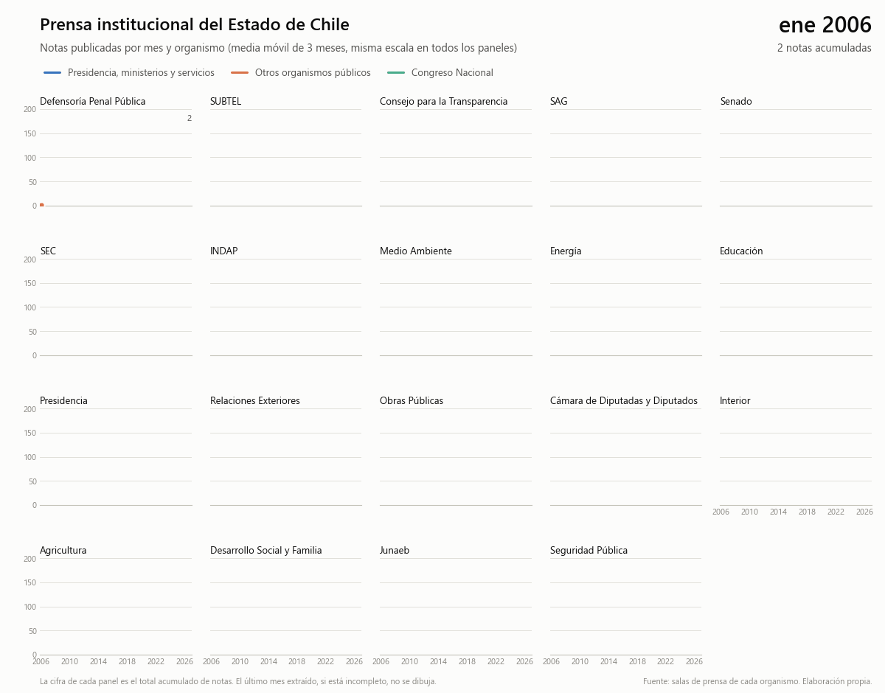

# Prensa institucional

Extracción de las notas de prensa que publican en sus sitios web distintos organismos del Estado de Chile: ministerios, subsecretarías, servicios públicos y el Congreso Nacional. Cada scraper recorre el listado de noticias de la sala de prensa y entra a cada nota para obtener el texto completo.



## Cobertura

Estado del corpus a la última extracción (julio de 2026 para el Ejecutivo y los otros organismos públicos; marzo y abril de 2026 para el Congreso).

| Organismo | Notas | Desde | Hasta |
|---|---:|---|---|
| Defensoría Penal Pública | 15.454 | ene 2006 | jul 2026 |
| Subsecretaría de Telecomunicaciones (SUBTEL) | 1.737 | jul 2006 | jul 2026 |
| Consejo para la Transparencia | 2.004 | abr 2008 | jul 2026 |
| Senado | 15.793 | feb 2010 | mar 2026 |
| Ministerio del Medio Ambiente | 3.770 | mar 2014 | jul 2026 |
| Ministerio de Energía | 7.119 | abr 2014 | jul 2026 |
| Ministerio de Educación | 2.825 | jul 2015 | jul 2026 |
| Ministerio de Relaciones Exteriores | 4.577 | ene 2017 | jul 2026 |
| Ministerio de Obras Públicas | 1.668 | ago 2017 | jul 2026 |
| Cámara de Diputadas y Diputados | 10.333 | sep 2017 | abr 2026 |
| Ministerio del Interior | 852 | mar 2018 | jul 2026 |
| Ministerio de Agricultura | 4.308 | may 2018 | jul 2026 |
| Ministerio de Desarrollo Social y Familia | 4.258 | ene 2020 | jul 2026 |
| **Total** | **74.698** | | |

Los datos no se incluyen en el repositorio. Se generan localmente corriendo los scrapers.

## Formato de salida

Cada scraper escribe `data/<organismo>.csv` en UTF-8, separado por comas, con los campos que contienen comas o saltos de línea entre comillas. Las columnas son siempre las mismas y en este orden:

| Columna | Contenido |
|---|---|
| `fecha` | Fecha de publicación (`AAAA-MM-DD`) |
| `institucion` | Nombre del organismo emisor |
| `titulo` | Título de la nota |
| `resumen` | Bajada o extracto que aparece en el listado |
| `url` | Enlace a la nota original |
| `contenido` | Texto completo de la nota |

## Uso

Requiere Python 3.10 o superior.

```bash
python -m venv .venv
source .venv/bin/activate          # en Windows: .venv\Scripts\activate
pip install -r requirements.txt
playwright install chromium
```

Ministerios, SUBTEL, Defensoría Penal Pública y Consejo para la Transparencia, en paralelo (los registros quedan en `logs/`):

```bash
python scrapers/run_todos_paralelo.py --jobs 4
python scrapers/run_todos_paralelo.py --only mma minrel   # solo algunos
```

Congreso, por separado:

```bash
python scrapers/scraper_senado.py
python scrapers/scraper_camara_diputados.py
```

Consolidar los once CSV del primer grupo en `data/prensa_institucional_consolidado.csv` y `.xlsx`, y regenerar la figura:

```bash
python scrapers/consolidar_prensa.py
python figuras/animacion_cobertura.py
```

Los scrapers incluyen pausas entre solicitudes. Úsalos con moderación y respetando las condiciones de cada sitio.

## Estructura

```
scrapers/
  scraper_<organismo>.py     un scraper por sala de prensa
  run_todos_paralelo.py      corre los scrapers del Ejecutivo y otros organismos en paralelo
  consolidar_prensa.py       une los CSV en un solo archivo (CSV y XLSX)
figuras/
  animacion_cobertura.py     genera cobertura.gif y cobertura.png
data/                        salida de los scrapers (no versionada)
```

## Limitaciones conocidas

- El corpus contiene lo que cada organismo mantiene publicado hoy. Los sitios se rediseñan y pierden archivo, así que la fecha de inicio indica lo disponible y no el comienzo de la actividad de prensa.
- Interior no tiene notas entre 2019 y 2021.
- SUBTEL no tiene notas en 2008 y 2009, y 35 notas no tienen fecha.
- Energía y Relaciones Exteriores tienen notas aisladas antes de su cobertura regular, que empieza en 2016 y 2018, respectivamente.
- Unas 430 notas de Energía y 235 de Educación no tienen el texto completo.
- Una nota del Consejo para la Transparencia tiene la fecha mal formada.

## Licencia

Código bajo licencia MIT. El contenido de las notas pertenece a cada organismo.
